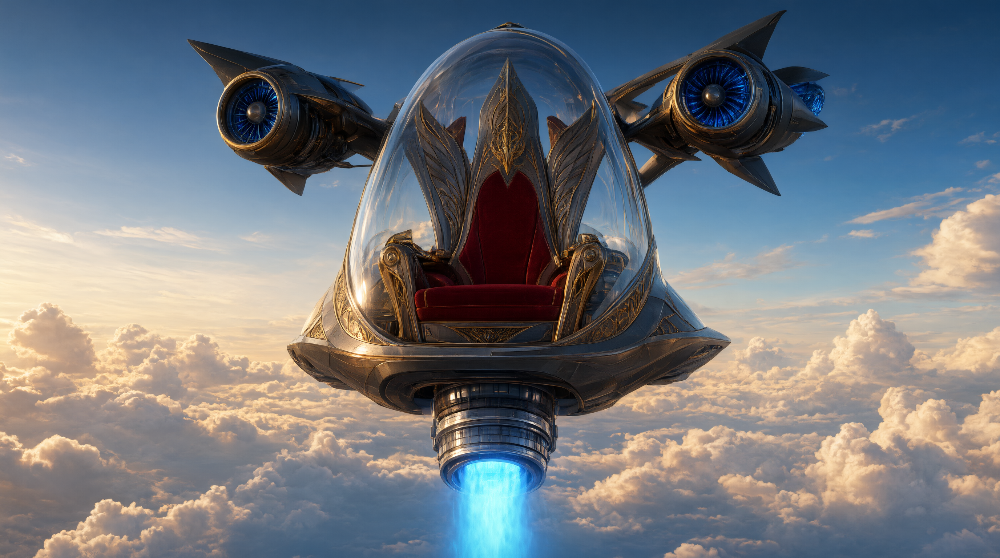

# ТЗ: Летающее кресло "Царь"

Автор: Сорокин Святослав Алексеевич
Стихия: воздух
Проект: Летающее кресло "Царь"
Репозиторий:
Дата заморозки:
Версия: 0.1 pre-alpha

## Назначение

Летающее кресло "Царь" - одноместное средство передвижения по воздуху, сочетающее в себе вертикальный взлёт и полёт по горизонтали. Пилот сидит ниже горизонтальных двигателей, и ему открывается отличный вид на всё происходящее вокруг и снизу. Конструкция позволяет погружаться в воду на глубину до 5000 метров на длительное время.



## Стихия и конструкционный элемент

Стихия: воздух

Конструкционный элемент: вертикальный двигатель под креслом, два горизотальных двигателя по бокам над креслом.

Как реализован элемент:
Вертикальный двигатель (атрибут vert_engine_power), создающий подъёмную силу, горизонтальные двигатели (horizont_engine_power), позволяющие лететь вперед и назад.

Ограничения стихии:
Основной режим - полёт.
Может погружаться в воду, но скорость и обзорность сильно ограничены.
Не предназначен для движения по земле.

## Публичный интерфейс

### Класс
Имя класса: FlyingChair

Модуль: flying_chair.py

### Конструктор
```
def __init__(
    self,
    name: str,
    mass_kg: float,
    vert_engine_power: float,
    horizont_engine_power: float,
    max_speed_kmh: float,
    battery: float,
) -> None:
```

| Параметр | Тип | Единица | Допустимый диапазон | Значение по умолчанию |
|----------|-----|---------|---------------------|----------------------|
| `name` | str | — | непустая строка | — |
| `mass_kg` | float | кг | > 0 | — |
| `vert_engine_power` | float | н | > 0 | — |
| `horizont_engine_power` | float | н | > 0 | — |
| `max_speed_kmh` | float | км/ч | > 0 | — |
| `bttery` | float | условные единицы | 0 ... 100 | 100.0 |

Исключения из конструктора:
- ValueError - если name пустой.
- ValueError — если mass_kg, vert_engine_power, horizont_engine_power или max_speed_kmh ≤ 0.
- ValueError — если battery вне диапазона 0…100.

### Атрибуты

| Атрибут | Тип | Единица | Доступ | Описание |
|---------|-----|---------|--------|----------|
| `name` | str | — | чтение | Имя транспорта |
| `mass_kg` | float | кг | чтение | Масса |
| `vert_engine_power` | float | н | чтение | Сила вертикального двигателя |
| `horizont_engine_power` | float | н | чтение | Сила горизонтального двигателя |
| `max_speed_kmh` | float | км/ч | чтение | Максимальная скорость |
| `battery` | float | условные единицы | чтение | Текущий заряд батареи |
| `position_km` | float | км | чтение | Пройденное расстояние |
| `is_flying` | bool | — | чтение | В воздухе ли транспорт |

### Методы

#### move
```
def move(self, distance_km: float, terrain: str) -> float:
```
Назначение: перемещает транспорт на заданное расстояние в заданной среде.
Параметры:
- distance_km — расстояние в км, > 0.
- terrain — среда: "air", "water", "ground".
Возвращает: время перемещения в часах (float).
Изменяет: position_km, battery, is_flying.
Исключения:
- ValueError — если distance_km ≤ 0.
- ValueError — если terrain не из списка.
- BatteryEmpty — если battery меньше затрат энергии на заданное расстояние, в том числе при разряженной батарее.
- FlyingChairCannotMoveOnGround — при попытке движения по земле.
Правила:
- В воздухе скорость = max_speed_kmh. 
- В воде скорость = max_speed_kmh * 0.5.
- На земле транспорт не может двигаться: FlyingChairCannotMoveOnGround (подкласс RuntimeError).
- Энергия тратится: distance_km * 2 в воздухе, distance_km * 1 в воде.
- is_flying = True, если terrain == "air", иначе False.
- При исключении position_km, battery и is_flying не меняются.

#### can_overcome
```
def can_overcome(self, obstacle: str) -> bool:
```
Назначение: проверяет, может ли транспорт преодолеть препятствие.

Параметры:
- obstacle - тип препятствия: "wall", "river", "tree", "mountain"
Возвращает: True / False.
Исключения:
- ValueError - если obstacle не из списка.
Правила:
- "wall" — только если is_flying.
- "river" — только если транспорт в воде (после последнего успешного move в среде "water") или может нырнуть (battery > 20).
- "tree" — только если vert_engine_power - mass_kg > 1.
- "mountain" - если vert_engine_power - mass_kg > 1.3 и battery > 50.

#### calculate_energy
```
def calculate_energy(self, distance_km: float, terrain: str) -> float:
```
Назначение: рассчитывает затраты энергии без изменения состояния.
Параметры: те же, что у move.

Возвращает: затраты энергии (float).

Исключения:
- ValueError — если distance_km ≤ 0 или terrain не из списка.
- TypeError — если параметры имеют неподходящий тип (см. раздел 6.2).

Расчёт для воздуха и воды использует те же формулы, что и move, и не зависит от текущего заряда. BatteryEmpty и FlyingChairCannotMoveOnGround при расчёте не возникают.

#### recharge
```
def recharge(self, amount: float) -> None:
```
Назначение: пополняет энергию.
Параметры:
-  amount — количество энергии, > 0.
Возвращает: None.
Изменяет: battery, но не выше 100.
Исключения:
- ValueError — если amount ≤ 0.

#### get_status
```
def get_status(self) -> dict:
```
Назначение: возвращает снимок состояния.
Возвращает: словарь с ключами:
- "name" — str,
- "battery" — float,
- "position_km" — float,
- "is_flying" — bool,
- "vert_engine_power" — float.
- "horizont_engine_power" — float.

## Сценарии
### Модульные тесты

### Сценарий 1. Обычный полёт
Дано: кресло с battery = 100,
max_speed_kmh = 150.
Когда: move(30, "air").
Тогда:
- возвращается 0.2 (30 / 150);
- position_km == 30;
- battery == 40 (100 − 30 × 2);
- is_flying == True.

### Сценарий 2. Полёт с нехваткой энергии
Дано: battery = 10, max_speed_kmh = 150.
Когда: move(30, "air").
Тогда: BatteryEmpty.

### Сценарий 3. Препятствие
Дано: кресло в полёте (is_flying = True).
Когда: can_overcome("wall").
Тогда: True.

### Сценарий 4. Зарядка
Дано: battery = 20.
Когда: recharge(50).
Тогда: battery == 70.

## Функциональные (сценарные) тесты

### Сценарий: Облет горы

**Given:** летающее кресло «Царь» с mass_kg = 80, vert_engine_power = 82,
horizont_engine_power = 50, max_speed_kmh = 150 и battery = 100.

**And:** кресло находится на земле: position_km = 0, is_flying = False.

**When:** пилот взлетает и летит 10 км к горе: move(10, "air").

**Then:** время полёта равно 10 / 150 ч.

**And:** position_km == 10, battery == 80, is_flying == True.

**When:** пилот проверяет возможность преодолеть гору: can_overcome("mountain").

**Then:** возвращается True, поскольку vert_engine_power − mass_kg = 2 > 1.3
и battery = 80 > 50.

**When:** пилот облетает гору, пролетая ещё 15 км: move(15, "air").

**Then:** время этого участка равно 0.1 ч (15 / 150).

**And:** position_km == 25, battery == 50, is_flying == True.

**When:** пилот проверяет возможность преодолеть следующую гору:
can_overcome("mountain").

**Then:** возвращается False, поскольку заряд равен 50, а требуется больше 50.

**When:** пилот пополняет заряд: recharge(30).

**Then:** battery == 80.

**When:** пилот повторяет проверку: can_overcome("mountain").

**Then:** возвращается True.

**When:** пилот пролетает ещё 10 км: move(10, "air").

**Then:** время этого участка равно 10 / 150 ч.

**And:** итоговое состояние: position_km == 35, battery == 60, is_flying == True.

### Сценарий: Подводный маршрут и перелёт через стену

**Given:** летающее кресло «Царь» с mass_kg = 80, vert_engine_power = 82,
horizont_engine_power = 50, max_speed_kmh = 150 и battery = 100.

**And:** position_km = 0, is_flying = False.

**When:** пилот летит 5 км к затопленному проходу: move(5, "air").

**Then:** время полёта равно 5 / 150 ч.

**And:** position_km == 5, battery == 90, is_flying == True.

**When:** пилот погружается и проходит 6 км под водой: move(6, "water").

**Then:** скорость равна 75 км/ч (150 × 0.5), время перемещения равно 0.08 ч (6 / 75).

**And:** position_km == 11, battery == 84, is_flying == False.

**When:** пилот проверяет возможность преодолеть стену из воды: can_overcome("wall").

**Then:** возвращается False, поскольку кресло не в полёте.

**When:** пилот всплывает и летит 1 км: move(1, "air").

**Then:** position_km == 12, battery == 82, is_flying == True.

**When:** пилот повторяет проверку стены: can_overcome("wall").

**Then:** возвращается True.

**When:** пилот перелетает стену и проходит ещё 3 км по воздуху: move(3, "air").

**Then:** время этого участка равно 0.02 ч (3 / 150).

**And:** итоговое состояние: position_km == 15, battery == 76, is_flying == True.

### Сценарий: Разряд батареи и продолжение полёта после зарядки

**Given:** летающее кресло «Царь» с mass_kg = 80, vert_engine_power = 82,
horizont_engine_power = 50, max_speed_kmh = 150 и battery = 20.

**And:** position_km = 0, is_flying = False.

**When:** пилот летит 10 км: move(10, "air").

**Then:** время полёта равно 10 / 150 ч.

**And:** position_km == 10, battery == 0, is_flying == True.

**When:** пилот пытается пролететь ещё 1 км: move(1, "air").

**Then:** возникает BatteryEmpty, поскольку батарея разряжена.

**And:** position_km остаётся равным 10, battery == 0.

**When:** пилот пополняет заряд: recharge(150).

**Then:** battery == 100: заряд ограничивается максимальным значением.

**When:** пилот рассчитывает расход для следующего участка: calculate_energy(30, "air").

**Then:** возвращается 60 (30 × 2).

**And:** состояние не меняется: position_km == 10, battery == 100, is_flying == True.

**When:** пилот летит запланированные 30 км: move(30, "air").

**Then:** время полёта равно 0.2 ч (30 / 150).

**And:** position_km == 40, battery == 40, is_flying == True.

**When:** пилот запрашивает состояние кресла: get_status().

**Then:** возвращается словарь с name == "Царь", battery == 40,
position_km == 40, is_flying == True, vert_engine_power == 82
и horizont_engine_power == 50.

## 6. Исключения и иерархия

### 6.1. Иерархия

```text
Exception
├── TypeError
├── ValueError
└── RuntimeError
    └── CrazyVehicleError
        └── FlyingChairError
            ├── BatteryEmpty
            └── FlyingChairCannotMoveOnGround
```

CrazyVehicleError — базовое доменное исключение транспорта, наследуется от RuntimeError.
FlyingChairError — базовое исключение летающего кресла.
BatteryEmpty — недостаточный заряд для перемещения.
FlyingChairCannotMoveOnGround — попытка движения по земле.

Ошибки типов и значений параметров вызывают стандартные TypeError и ValueError.
Нарушения правил эксплуатации вызывают доменные исключения FlyingChairError.
Если известное препятствие нельзя преодолеть, can_overcome возвращает False,
а не вызывает исключение.

### 6.2. Таблица

| Ситуация | Исключение | Сообщение |
|----------|------------|-----------|
| name, terrain или obstacle имеет тип, отличный от str | TypeError | "<parameter> must be a string" |
| Числовой параметр конструктора или метода имеет тип, отличный от int или float; bool также не допускается | TypeError | "<parameter> must be a number" |
| Пустое имя кресла | ValueError | "name must not be empty" |
| mass_kg ≤ 0 | ValueError | "mass_kg must be positive" |
| vert_engine_power ≤ 0 | ValueError | "vert_engine_power must be positive" |
| horizont_engine_power ≤ 0 | ValueError | "horizont_engine_power must be positive" |
| max_speed_kmh ≤ 0 | ValueError | "max_speed_kmh must be positive" |
| battery вне диапазона 0…100 при создании кресла | ValueError | "battery must be between 0 and 100" |
| distance_km ≤ 0 в move или calculate_energy | ValueError | "distance_km must be positive" |
| Неизвестная среда в move или calculate_energy | ValueError | "unknown terrain: <terrain>" |
| Неизвестное препятствие в can_overcome | ValueError | "unknown obstacle: <obstacle>" |
| amount ≤ 0 в recharge | ValueError | "amount must be positive" |
| move вызывается с terrain == "ground" | FlyingChairCannotMoveOnGround | "flying chair cannot move on ground" |
| Заряда недостаточно для move: battery < calculate_energy(distance_km, terrain) для воздуха или воды | BatteryEmpty | "not enough battery: required <required>, have <battery>" |

В сообщениях значения в угловых скобках заменяются фактическими именами параметров
или переданными значениями. Сначала проверяются типы и допустимые значения
параметров, затем возможность движения по земле и достаточность заряда.
При неудачном вызове состояние кресла не меняется.
Если заряда хватает ровно на перемещение, move завершается успешно,
а battery становится равным 0.

## 7. Что вне рамок

- Транспорт не взаимодействует с другими транспортами.
- Нет графики, анимации и визуализации полёта или погружения.
- Нет сохранения состояния между запусками.
- Нет обработки внешних файлов, подключения к API и реального управления двигателями.
- Не моделируются ветер, погода, давление воды, видимость и столкновения.
- Не рассчитываются физическая подъёмная сила, траектория, высота полёта и глубина погружения. Заявленная глубина до 5000 метров описывает конструкцию; в программном интерфейсе глубина не задаётся и не проверяется.
- Не моделируются повреждения двигателей, ремонт, износ и деградация батареи.
- Нет отдельной модели пилота, его массы и систем жизнеобеспечения.
- Нет движения по земле; соответствующий вызов завершается исключением.
- Нет отдельных команд поворота, посадки и движения назад. position_km хранит суммарное пройденное расстояние, а не координаты маршрута.

## 8. Трассируемость «требование → тест»

Таблица задаёт план покрытия требований до реализации. Имена в столбце «Тест» —
имена будущих тестовых методов. Для строк с несколькими входными значениями
используются параметризованные проверки. Наличие строки не означает,
что тест уже реализован.

| Требование | Раздел ТЗ | Тест |
|------------|-----------|------|
| Класс FlyingChair доступен из flying_chair.py; конструктор сохраняет переданные параметры | Публичный интерфейс → Класс, Конструктор | test_TC_M_001_init_stores_parameters |
| Имя кресла не может быть пустым | Конструктор; 6.2 | test_TC_M_002_init_empty_name_raises |
| mass_kg, vert_engine_power, horizont_engine_power и max_speed_kmh должны быть положительными | Конструктор; 6.2 | test_TC_M_003_init_nonpositive_parameters_raise |
| Начальный заряд допускает значения 0 и 100, но не значения вне диапазона | Конструктор; 6.2 | test_TC_M_004_init_battery_bounds |
| При создании position_km == 0 и is_flying == False | Функциональные тесты → Облет горы | test_TC_M_001_init_stores_parameters |
| Публичные атрибуты доступны для чтения и имеют заявленные типы | Публичный интерфейс → Атрибуты | test_TC_M_005_public_attributes_types |
| Публичные атрибуты нельзя изменять прямым присваиванием | Публичный интерфейс → Атрибуты | test_TC_M_006_public_attributes_read_only |
| В воздухе скорость равна max_speed_kmh, время равно distance_km / max_speed_kmh | Методы → move | test_TC_M_007_move_air |
| Полёт расходует distance_km × 2 единицы заряда | Методы → move; Сценарий 1 | test_TC_M_007_move_air |
| В воде скорость вдвое меньше воздушной | Методы → move | test_TC_M_008_move_water |
| Движение в воде расходует distance_km единиц заряда | Методы → move | test_TC_M_008_move_water |
| Последовательные перемещения увеличивают суммарное position_km | Методы → move; Функциональные тесты | test_TC_S_004_accumulated_route |
| В воздухе is_flying == True, в воде — False | Методы → move; Подводный маршрут и перелёт через стену | test_TC_M_040_move_switches_flight_state |
| При достаточном заряде move возвращает float | Методы → move | test_TC_M_007_move_air |
| Движение по земле вызывает FlyingChairCannotMoveOnGround | Методы → move; 6.1–6.2 | test_TC_M_009_move_ground_raises |
| При нулевом или недостаточном заряде move вызывает BatteryEmpty | Методы → move; Сценарий 2; 6.2 | test_TC_M_010_move_insufficient_battery_raises |
| При точном совпадении заряда и расхода движение успешно, battery == 0 | Функциональные тесты → Разряд батареи; 6.2 | test_TC_M_011_move_exact_battery_succeeds |
| При ошибке move заряд, расстояние и признак полёта не меняются | Методы → move; 6.2 | test_TC_M_012_move_error_preserves_state |
| move и calculate_energy отклоняют нулевую и отрицательную дистанцию | Методы → move, calculate_energy; 6.2 | test_TC_M_013_distance_nonpositive_raises |
| move и calculate_energy отклоняют неизвестную среду | Методы → move, calculate_energy; 6.2 | test_TC_M_014_unknown_terrain_raises |
| Стена преодолевается только в полёте | Методы → can_overcome; Сценарий 3 | test_TC_M_015_overcome_wall_requires_flight |
| Река преодолевается в воде даже при battery ≤ 20 | Методы → can_overcome | test_TC_M_016_overcome_river_in_water |
| Вне воды река преодолевается только при battery > 20; при battery == 20 возвращается False | Методы → can_overcome | test_TC_M_017_overcome_river_battery_threshold |
| Дерево преодолевается при vert_engine_power − mass_kg > 1; при разности 1 возвращается False | Методы → can_overcome | test_TC_M_018_overcome_tree_power_threshold |
| Гора преодолевается только при vert_engine_power − mass_kg > 1.3 и battery > 50; равенство любому порогу не подходит | Методы → can_overcome; Облет горы | test_TC_M_019_overcome_mountain_thresholds |
| Для известного препятствия can_overcome возвращает bool, включая False при невозможности преодоления | Методы → can_overcome; 6.1 | test_TC_M_020_can_overcome_returns_bool |
| Неизвестное препятствие вызывает ValueError | Методы → can_overcome; 6.2 | test_TC_M_021_unknown_obstacle_raises |
| calculate_energy возвращает float: distance_km × 2 для воздуха и distance_km для воды | Методы → calculate_energy | test_TC_M_022_calculate_energy_matches_move_cost |
| calculate_energy не меняет состояние и работает при нулевом или недостаточном заряде | Методы → calculate_energy | test_TC_M_024_calculate_energy_independent_of_battery |
| recharge увеличивает battery и возвращает None | Методы → recharge; Сценарий 4 | test_TC_M_025_recharge_adds_battery |
| Зарядка не увеличивает battery выше 100 | Методы → recharge; Разряд батареи и продолжение полёта после зарядки | test_TC_M_026_recharge_caps_at_100 |
| recharge отклоняет amount ≤ 0 | Методы → recharge; 6.2 | test_TC_M_027_recharge_nonpositive_raises |
| Зарядка не меняет position_km и is_flying | Методы → recharge | test_TC_M_028_recharge_preserves_position_and_flight |
| get_status возвращает словарь со всеми шестью заявленными ключами, типами и актуальными значениями | Методы → get_status | test_TC_M_029_status_keys_types_and_values |
| Изменение словаря get_status не меняет состояние кресла | Методы → get_status (снимок состояния) | test_TC_M_030_status_is_snapshot |
| Неверные типы строковых и числовых параметров, включая bool вместо числа, вызывают TypeError | 6.2 | test_TC_M_031_invalid_string_parameter_types_raise, test_TC_M_032_invalid_numeric_parameter_types_raise |
| Доменная иерархия наследуется от RuntimeError; оба исключения кресла — от FlyingChairError | 6.1 | test_TC_M_033_exception_hierarchy |
| Текст исключений соответствует таблице и содержит фактические значения | 6.2 | test_TC_M_034_exception_messages |
| Ошибки валидации проверяются раньше доменных ограничений и не меняют состояние | 6.2 | test_TC_M_035_validation_order_and_state |
| Полный маршрут вокруг горы с проверкой порога заряда и подзарядкой | Функциональные тесты → Облет горы | test_TC_S_001_mountain_flight |
| Подводный участок, переход в полёт и проверка преодоления стены | Функциональные тесты → Подводный маршрут и перелёт через стену | test_TC_S_002_underwater_and_wall |
| Полный разряд, отказ движения, зарядка, расчёт расхода и продолжение полёта | Функциональные тесты → Разряд батареи и продолжение полёта после зарядки | test_TC_S_003_battery_recovery |
